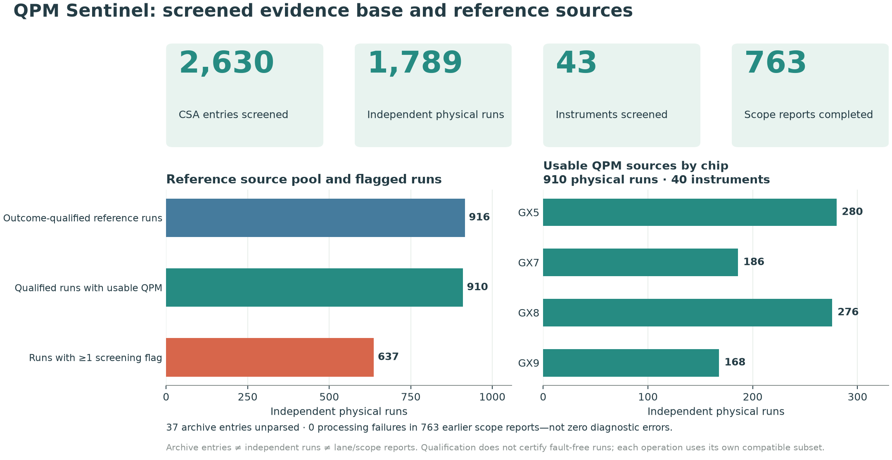
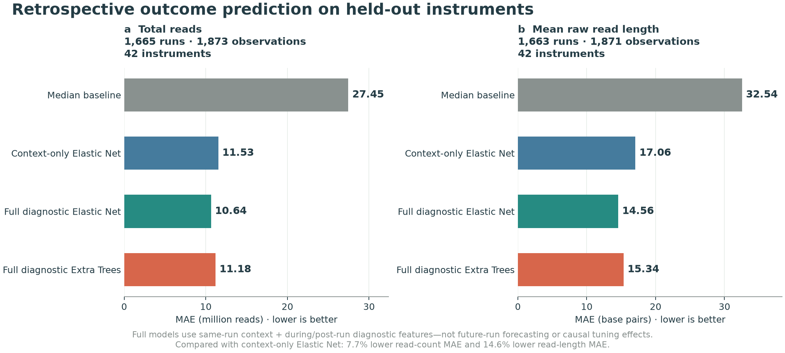
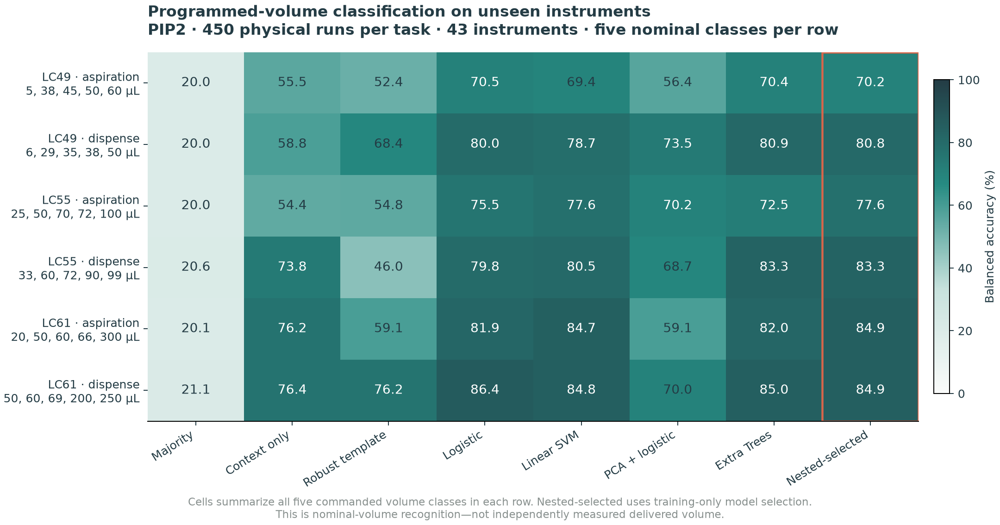
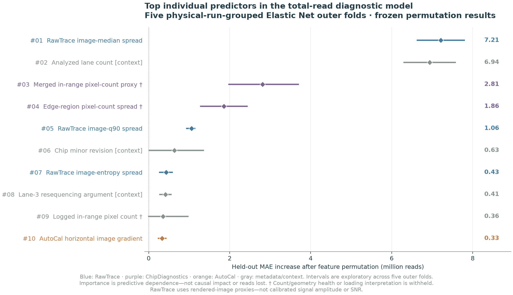
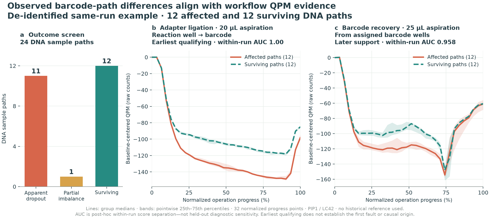
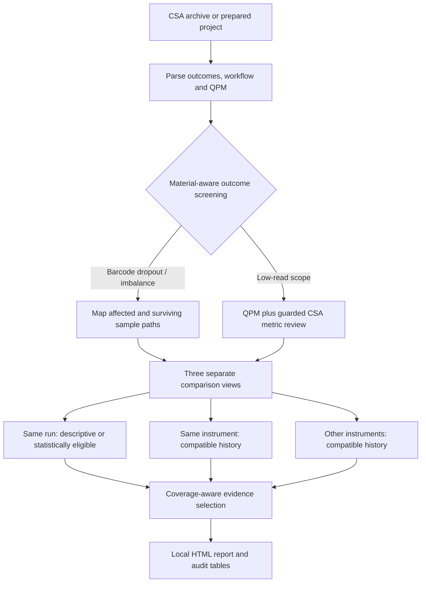

# QPM Sentinel

### From hidden signals to explainable sequencing diagnostics

QPM Sentinel turns Genexus Customer Support Archives (CSAs) into auditable,
barcode-aware troubleshooting reports. It connects **Qualitative Pipetting
Monitoring (QPM)** waveforms, workflow steps, sequencing outcomes and selected
CSA diagnostics—without automatically changing instrument settings.

**Private/internal research and engineering prototype · plugin snapshot 0.18.0**

This portable source package passed **338 automated software tests**. See
[`validation/tests.json`](validation/tests.json) and the documented
[source-snapshot adjustments](docs/source_snapshot_manifest.json). Tests are not
validation of diagnostic sensitivity, actual delivered volume or clinical use.

> Diagnostic evidence is not a confirmed root cause. Nominal-volume recognition
> is not measured delivered volume. Same-run outcome modeling is not next-run
> forecasting. This is not a validated clinical decision-support product.

## Why this matters

- QPM data is buried across thousands of debug-log steps—hard to access,
  interpret and use.
- Barcode dropout, imbalance and low-read runs can remain unresolved after
  routine review, wasting samples and investigation time.
- One evidence-linked report makes these signals accessible beyond specialists
  who manually inspect instrument logs.

## What it does

| Investigation | Evidence used | Report output |
|---|---|---|
| Apparent barcode dropout / imbalance | Material-aware barcode outcomes and mapped QPM paths | Affected versus surviving curves, earliest **covered/qualifying** evidence and later supporting events |
| Low sequencing performance | QPM plus guarded CSA metric comparisons and frozen model rankings | Separate QPM and low-read metric sections, including unresolved or counter-evidence |
| Supported volume-recognition tasks | Quality-cleared waveforms and verified command context | Nominal/programmed-volume resemblance, **not** a calibrated transfer measurement |

The report exposes **same-run**, **same-instrument historical** and
**cross-instrument historical** comparisons separately. Sparse same-run curves
remain visible but descriptive. A missing reference or metric is not silently
treated as normal.

## Major results

These are frozen retrospective study results—not new experiments run during
repository packaging. Cohorts differ by task; the counts below are not all
training-set sizes.

### 1. A fleet-scale archive and reporting workflow

| Measure | Result |
|---|---:|
| CSA archive entries screened | 2,630 |
| Independent physical runs in the screened cohort | 1,789 |
| Instruments in the screened cohort | 43 |
| Physical runs with at least one screening flag | 637 |
| Completed QPM scope reports in the frozen cohort batch | 763 |
| Processing failures in that batch | 0 |
| Outcome-qualified reference-source physical runs | 916 |
| Physical runs supplying usable QPM reference traces | 910 across 40 instruments |



**Scope matters:** 37 archive entries were unparsed. A physical run can have
multiple analyzed lane scopes. Zero processing failures does not mean zero
diagnostic errors. Reference qualification is not certification of fault-free
operation. The 763-report batch predates 0.18.0; that release regenerated three
selected examples, not the entire cohort.

### 2. Retrospective outcome models beat the median baseline

Leave-one-instrument-out **Elastic Net** results:

| Outcome / MAE ↓ | Median baseline | Context only | Full diagnostic model |
|---|---:|---:|---:|
| Total reads, million reads | 27.45 | 11.53 | **10.64** |
| Mean raw read length, bp | 32.54 | 17.06 | **14.56** |



The harder comparison is against context alone: the full model reduced MAE by
approximately **7.7% for reads** and **14.6% for read length**. Context explains
much of the apparent gain over a simple median baseline. These held-out results
cover 1,665 read-count and 1,663 read-length physical runs across **42**
instruments; they use context and during/post-run diagnostics from the same run.
Raw read accuracy could not be validated because labels were insufficient.

### 3. QPM waveforms recognize programmed-volume signatures

Six PIP2 tasks compare aspiration and dispense for liquid classes 49, 55 and 61.
Each task uses five nominal volume levels, 450 physical runs and 43 instruments.



The heatmap shows **balanced classification accuracy**, not actual delivered-volume
accuracy. Row labels list the commanded volume classes. A separate all-operation,
run-balanced regression benchmark achieved **12.18 µL nominal-volume MAE** and
**52.8% within ±10% of the programmed volume** with Extra Trees on unseen
instruments. Those are different tasks and denominators; do not combine them
into one accuracy claim. MAE has units: **accuracy is not `1 − MAE`**.

Independent volume metrology is still needed before claiming an actual
aspiration/dispense deficit or excess.

### 4. Model contributors prioritize review—not causal verdicts



RawTrace image descriptors, chip-diagnostic descriptors and run context can
prioritize investigation. Importance is held-out prediction-error increase
after shuffling—not reads lost, a local attribution or an experimentally
established effect. Correlated features can share or mask importance.

RawTrace image summaries are **rendered-image proxies**, not calibrated physical
signal or chemistry measurements. Ambiguous pixel-count/geometry proxies are
not interpreted as loading or chip-health percentages. TrueLoading and other
quarantined feature families must not be revived as validated causal drivers.
No reliable tunable pre-run setting or vacuum/pipette setpoint effect has been
established.

### What did not work reliably

A separate six-instrument, 312-run next-run forecasting study did **not**
establish reliable added forecasting value from broad prior-CSA features beyond
recent outcomes. This is a limitation of the tested experiment, not proof that
prognostic signals cannot exist. Do not present retrospective diagnostic models
as validated future-run predictors.

### Barcode-aware localization: one deidentified example

An examined DNA-only run contained **11 apparent dropouts, one imbalance and
12 surviving paths**. The earliest qualifying 20 µL reaction-well-to-barcode
aspiration separated affected and surviving waveforms; a later 25 µL recovery
aspiration supplied supporting evidence.



Within-run, outcome-conditioned separation AUC was **1.00** and **0.96** at those
two steps. This is **not held-out diagnostic sensitivity** or proof of transfer
failure. The earliest qualifying group is not necessarily the first abnormal
operation. The plot shows only group medians/IQR and class counts—no individual
barcode, instrument or run identifiers. Its measured QPM summaries must not be
confused with independently measured delivered volume.

Aggregate numbers and the portable figure renderer are in
[`docs/data/`](docs/data/) and [`tools/render_results.py`](tools/render_results.py).
See the [model card](docs/model_card.md) for interpretation boundaries.
The [data contract](docs/data_contract.md) describes source fields and units.

## How it works



Historical waveform references match the **physical operation definition**,
including liquid class, programmed volume, container/deck geometry, command
settings and pipette. Additional matching applies where required, including
chip-coupler contexts. A matching operation index alone is not sufficient.
Each operation requires its own compatible reference subset; eight qualifying
runs somewhere in the bank do not make every operation scorable.

## Quick start: no CSA or production assets needed

Tested with Python **3.11.16** on Linux. Dependency pins capture the tested
environment; use your organization's approved package index if required.

```bash
python -m venv .venv
source .venv/bin/activate
python -m pip install -r requirements.txt

python examples/run_synthetic_demo.py --output outputs/demo
python tools/run_tests.py
python tools/render_results.py
```

Open the HTML file printed by the demo. The demo uses the actual diagnostic
core with **explicitly synthetic** inputs. It checks software behavior; it does
not reproduce clinical outcomes, train a volume model or validate diagnostic
accuracy. The repository's real aggregate-result figures are separate from
that synthetic demonstration.

## Run on your own approved CSA data

Place data outside the tracked source tree. Full historical-reference and
registered-model functionality requires the separately managed private assets
described in [the artifact guide](docs/private_assets.md).

### Existing prepared project / reference snapshot

```bash
python pipeline/qpm_dropout_plugin.py \
  --project /path/to/approved/project \
  --observation-id YOUR_OBSERVATION_ID \
  --config configs/qpm_dropout_plugin_config.json \
  --output-dir outputs/my_run
```

Use exactly one selector: `--observation-id`, `--archive-id` or `--run-name`.
An absent reference remains unresolved; the software must not fabricate one.

### New archives in a local folder

```bash
python pipeline/run_manual_csa_plugin.py \
  --input-dir /path/to/approved/csa_folder \
  --baseline /path/to/approved/reference_snapshot \
  --out outputs/manual_replay \
  --stage all
```

The manual runner processes local inputs; the demo does not require instrument
connectivity. Read-only instrument collection is a separate, optional workflow.
See [usage](docs/usage.md) for collection, parsing, model training and reporting
entry points.

## Screening and statistical guardrails

- DNA and RNA are screened separately, excluding identified controls. Missing
  barcode outcomes remain unresolved, not zero or normal.
- The user-defined read criteria are **12.5M per analyzed lane for GX5**, **25M
  for GX7/GX8**, and **50M for GX9**, multiplied by the relevant analyzed lane
  count. These are project screening criteria—not manufacturer acceptance limits.
- Same-run inferential comparisons require at least three independent affected
  and three surviving paths. One-versus-many curves may be shown descriptively;
  retries do not create independent biological replication.
- Historical comparisons require at least eight compatible independent physical
  runs, not eight repeated events. Same-instrument and cross-instrument results
  stay separate; coverage and exclusions are reported.
- Er72 traces are excluded from waveform scoring and evidence selection.
- Sibling lanes/reanalyses stay in the same validation group. Training-fold
  preprocessing and selection prevent target-based cross-validation leakage.
- “Earliest” means earliest **covered/qualifying** evidence under the applicable
  rule—not necessarily the first abnormal operation or causal origin.
- No report changes instrument, liquid-transfer, assay or analysis settings.

## Repository contents

```text
qpm-sentinel/
├── README.md
├── pipeline/              # Runtime, parsing, reference and training modules
├── configs/               # Portable example policies; no instrument credentials
├── examples/              # Synthetic, offline diagnostic demonstration
├── tests/                 # Packaged regression/unit tests
├── tools/                 # Figure rendering, checks and packaging helpers
└── docs/
    ├── assets/            # README figures; no identifying run screenshots
    ├── data/              # Aggregate benchmark tables and provenance
    ├── model_card.md
    ├── private_assets.md
    ├── privacy.md
    └── usage.md
```

**Not in the Git upload:** raw CSA archives, run/sample-level datasets,
production reference banks, trained pickle/joblib payloads, customer reports,
SSH configuration, credentials, presentation templates or illustrative
replacement measurements. The code bundle and production-data assets are not
interchangeable.

## Reproducibility and security

Run `python tools/validate_package.py` before upload. It checks the package,
relative documentation links, required assets and common accidental data/secret
inclusions. These automated checks are a safeguard, not a guarantee that an
external publication is approved or that all sensitive content was detected.

Only load trusted, hash-verified model artifacts: pickle/joblib files can execute
code. Run archive processing with appropriate local resource and access controls.
Read [privacy](docs/privacy.md), [security](SECURITY.md) and
[publication status](NOTICE.md) before distribution.

## Upload the prepared package

Extract the upload ZIP and upload the **contents** of `qpm-sentinel/`, not the ZIP
itself, to your new **private/internal** repository. Keep `.gitignore` and review
the [upload checklist](docs/upload.md). No GitHub repository, remote or external
upload is created by this package.

## Team and next steps

**Yan Zhu · Chao Wang**

Next: blinded expert-reviewed cases and controls, independently measured
transfer volumes, representative instrument/assay validation, and a shadow-mode
pilot measuring investigation time, false alarms, abstentions and repeat-run
costs. Potential savings have not yet been quantified.

This private/internal snapshot does **not** grant an open-source license.
Public release requires the rights holder's approval and an explicit license.

